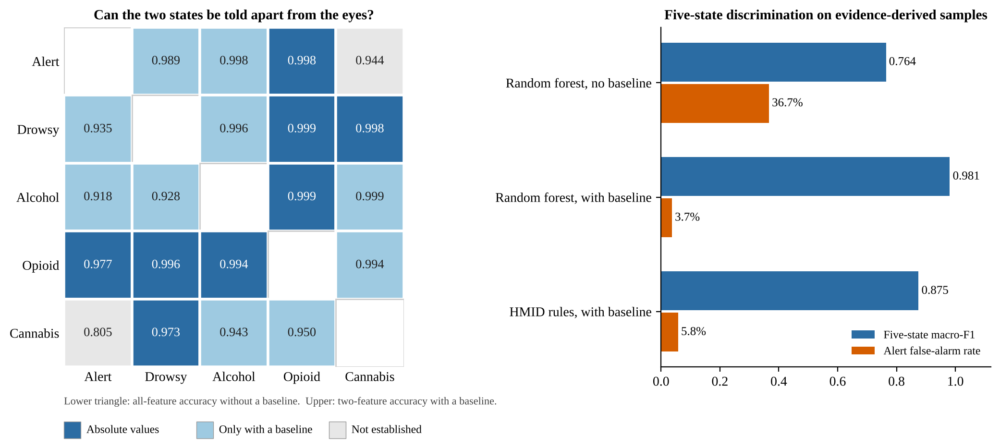
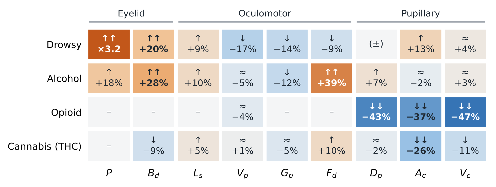
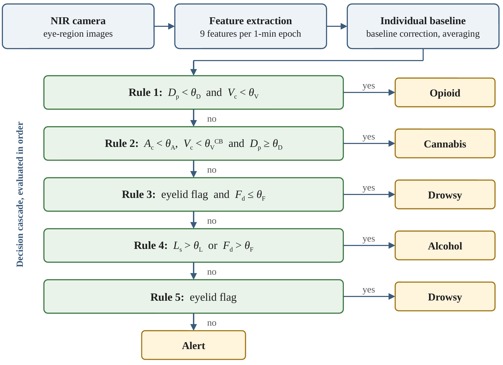
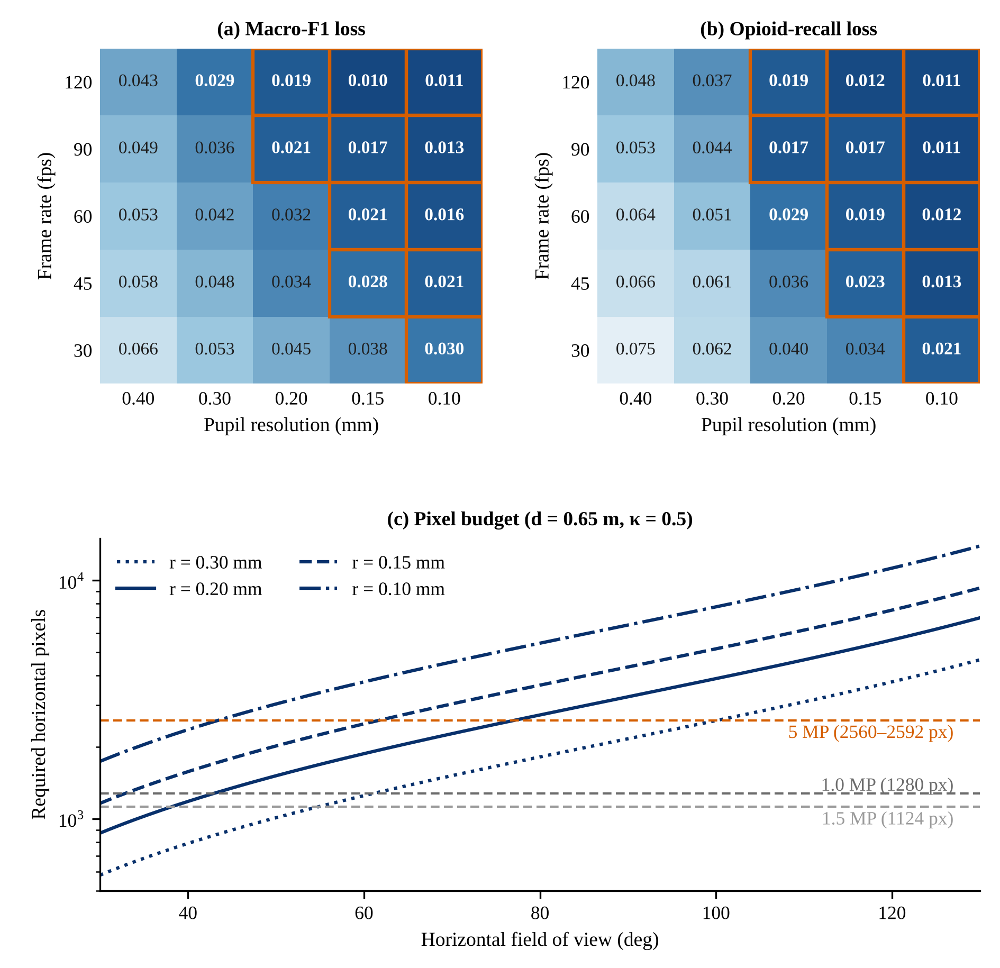

# drug-virtual-driver-criteria

Code and extracted data for

> C. Oh, W. Kim. *Virtual-Driver Generation Criteria and Camera Requirements for Evaluating Drug-Impairment Detection in Driver Monitoring Systems.* Manuscript submitted for publication.

From 2026, Euro NCAP checks whether driver monitoring systems (DMS) detect impairment other than fatigue, including drugs. Drug-impaired drivers cannot be put in a test vehicle, so the test material has to come from virtual drivers. This repository holds the evidence synthesis and analysis behind the paper: how the eyes of a virtual driver should behave when drowsy, under alcohol, under opioids or under cannabis, whether those states can be told apart, and what camera is needed to measure the difference.

Everything in the paper (tables, figures and numbers in the text) can be regenerated from the files here.

## Results at a glance



- **Opioids** are separated from the alert, drowsy and alcohol states by absolute values: pupil diameter −43% and PLR constriction velocity −47% together.
- **Cannabis** is separated from drowsiness by an attenuated PLR (amplitude −26%) with almost no change in pupil size.
- **Drowsiness vs. alcohol** and **alert vs. cannabis** are not separable from a single 1-min observation without an individual baseline. With a stored baseline and a few minutes of averaging most pairs reach 0.99, so the limit is between-driver variability rather than a lack of indicators.

### Generation criteria for virtual drivers

Direction and pooled size of the change in each ocular feature, relative to the alert state.



| State | Generate together | Nearest confuser: separating axis |
|---|---|---|
| Drowsy | P↑↑, B_d↑↑, V_p↓, G_p↓, A_c↑ | Alcohol: fixation duration (−9% vs. +39%), eye closure (×3.2 vs. +18%) |
| Alcohol | P↑, B_d↑↑, L_s↑, G_p↓, F_d↑↑ | Alert: blink duration +28%, fixation duration +39% |
| Opioid | D_p↓↓, A_c↓↓, V_c↓↓ | Cannabis: constriction velocity (−47% vs. −11%), pupil diameter (−43% vs. −2%) |
| Cannabis | F_d↑, A_c↓↓, V_c↓ (pupil size kept) | Alert: PLR amplitude −26%, blink duration −9% |

↑/↓ = 5–20%, ↑↑/↓↓ = 20% or more. P eye closure, B_d blink duration, L_s saccade latency, V_p saccadic peak velocity, G_p pursuit gain, F_d fixation duration, D_p pupil diameter, A_c PLR amplitude, V_c PLR constriction velocity.

Confounding cases are generated as well: bright-light miosis with an intact PLR (must stay "alert"), combined alcohol and drowsiness, and a low-dose oral opioid profile.

### Reference discriminator (HMID)

A rule cascade built directly from the criteria; it needs no training.



### Camera requirements

Coarsest pupil resolution that keeps the loss in macro-F1 and in opioid recall within 0.03 of noise-free measurement:

| Frame rate | 30 fps | 45–60 fps | 90–120 fps |
|---|---|---|---|
| Pupil resolution | 0.10 mm | 0.15 mm | 0.20 mm |

At a 50° field of view and 0.65 m, 60 fps needs about 2,020 horizontal pixels (≈3 MP). Current 1–1.5 MP driver cameras give 0.24–0.27 mm and fall short.



## Repository layout

| Path | Contents |
|---|---|
| `evidence/` | Study-level extractions, one file per state (drowsiness, alcohol, opioid, cannabis). Each quantified value keeps its sample size, condition, device, location in the source and the supporting sentence. |
| `src/synth.py` | Quality appraisal and effect pooling (relative effects, n-weighted) → `results/params.json` |
| `src/core.py` | Shared model: generator, variance model, camera noise model, Bayes boundaries, HMID rules |
| `src/exp3_discrimination_criteria.py` | Pairwise criteria and verdicts → `results/results3.json` |
| `src/exp1_criteria_verification.py` | Classifier verification, sensitivity, channel ablation, probe conditions → `results/results.json` |
| `src/exp2_camera_requirements.py` | Frame rate × pupil resolution map and pixel budget → `results/results2.json` |
| `src/reaggregate_multistate.py` | Re-aggregation of the published confusion matrices of the direct-comparison studies |
| `src/make_*.py` | Figures. Block diagrams (Figs. 1–2) are written as editable PowerPoint files to `figures/src/` |
| `results/` | Outputs used in the paper (`*_noproxy.json`: sensitivity run without the pursuit-time proxy studies) |

The samples used for verification are drawn from the evidence-derived distributions. They are feature-level samples, not rendered virtual drivers.

## Running

Python 3.9 or later.

```bash
pip install -r requirements.txt
bash run_all.sh        # Linux / macOS
run_all.bat            # Windows
```

A full run takes roughly 10–30 minutes on a laptop; `exp1` is the slowest step. PNG export of the two block diagrams uses LibreOffice (`soffice`) and `pdftoppm` if they are installed; otherwise the `.pptx` files are still written.

## Licence

Code: MIT (see `LICENSE`). Extracted data in `evidence/` and `results/`: CC BY 4.0. The source articles themselves are not included; they are listed with DOIs in `evidence/`.

## Citation

See `CITATION.cff`. Please cite the paper once it is published.
